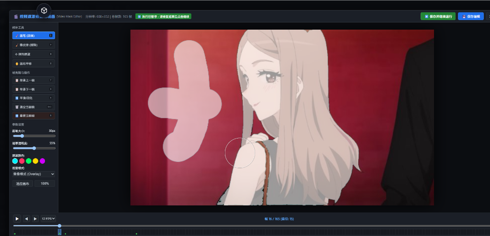
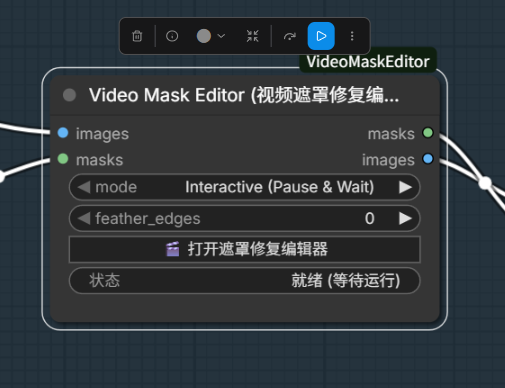

# ComfyUI-VideoMaskEditor

[](https://opensource.org/licenses/MIT)
[](https://github.com/comfyanonymous/ComfyUI)

An interactive video mask editor node for **ComfyUI**. Designed specifically to solve **mask flickering, missing frames, and sudden dropouts** caused by video segmentation models (such as SAM, SAM2, SAM3, and SAM3.1) before feeding masks into downstream diffusion pipelines (Wan, MiniMax H3, LTX-Video, CogVideoX, AnimateDiff) or subject crop tools (`MVEx Subject Crop`).

[中文文档](#中文说明) | [English Documentation](#english-documentation)

---

### 📸 Preview / 界面预览

| 全屏交互式遮罩修复编辑器 (Interactive Canvas Editor) |
| :---: |
|  |

| ComfyUI 工作流节点 (Node in Graph) |
| :---: |
|  |

---

<a name="english-documentation"></a>
## English Documentation

### 💡 Why VideoMaskEditor?

When tracking objects or segmenting videos using SAM/SAM3.1, models frequently produce occasional "bad frames" where the mask completely disappears, flickers, or loses a major chunk. A single bad frame can ruin the entire downstream video generation in diffusion models (Wan2.1, MiniMax H3, LTX-Video, CogVideoX, AnimateDiff) or cause video crops to jump.

**ComfyUI-VideoMaskEditor** provides a full-featured visual editor right inside your ComfyUI workflow:
1. **Zero-disruption workflow**: Pause execution on this node while you fix bad masks, then continue seamlessly.
2. **Auto-Flicker Detection**: Highlights suspicious frames with `⚠️` markers where mask area suddenly drops or disappears.
3. **One-key Frame Borrowing**: Inherit the mask from the previous (`P`) or next (`N`) frame instantly.
4. **Full Drawing Suite**: Paint, erase, magic-wand select, translate, feather edges, zoom, pan, and playback.
5. **Multi-frame Editing**: Select frames directly on the timeline and apply one brush, eraser, or magic-wand operation across them without replacing their existing masks.

---

### ✨ Features

- 🖼️ **Full-Featured Canvas Editor**:
  - **Brush & Eraser**: Custom size and hardness.
  - **Magic Wand**: Add or remove contiguous/color-similar regions with adjustable tolerance.
  - **Move Mask**: Translate the mask freely on the frame.
  - **Feathering**: Smooth out jagged or harsh mask edges.
  - **Mask Color & Opacity**: Customize overlay visibility for maximum precision.
  - **Zoom & Pan**: Smooth mouse wheel zooming and middle-click panning.
- 🎞️ **Video Timeline & Scrubber**:
  - Frame-accurate scrubber with thumbnail previews.
  - Real-time video playback at adjustable FPS.
  - Edited frames marked with green dots (`●`).
  - Missing or flickering masks highlighted with warning badges (`⚠️`).
  - Click, `Shift`-click, `Ctrl`-click, or drag across the timeline to select frames for batch editing.
- ⚡ **Workflow Control Modes**:
  - `Interactive (Pause & Wait)`: Freezes execution when frames arrive; open editor, edit, and click **"Save & Continue"** to send fixed masks directly to downstream nodes.
  - `Use Edited or Passthrough`: Non-blocking. Uses cached edits if available, or passes through untouched.
  - `Block Downstream`: Halts execution at this node for review.
- ⌨️ **Extensive Keyboard Shortcuts**: Designed for high-speed frame cleanup.

---

### ⌨️ Keyboard Shortcuts

| Key | Action |
| --- | --- |
| `Space` | Play / Pause video timeline |
| `←` / `→` (Left / Right Arrow) | Previous frame / Next frame |
| `B` | Brush tool |
| `E` | Eraser tool |
| `W` | Magic Wand tool |
| `M` | Move / Translate mask tool |
| `[` / `]` | Decrease / Increase brush size |
| `P` | Copy mask from **Previous** frame |
| `N` | Copy mask from **Next** frame |
| `Ctrl + Z` | Undo edit |
| `Ctrl + Y` | Redo edit |
| `Ctrl + S` | Save current frame |
| `F` | Fit canvas to screen |
| `Wheel` | Zoom in / Zoom out |
| `Middle Click` / `Alt + Drag` | Pan canvas |
| `Esc` | Clear a multi-frame selection; press again to close the editor |

---

### 📦 Installation

#### Option 1: Git Clone (Recommended)
Navigate to your ComfyUI `custom_nodes` directory and clone this repository:
```bash
cd ComfyUI/custom_nodes
git clone https://github.com/knoic/ComfyUI-VideoMaskEditor.git
```

Dependencies are standard ComfyUI packages (`torch`, `torchvision`, `numpy`, `Pillow`, `aiohttp`). If needed, install via:
```bash
pip install -r ComfyUI-VideoMaskEditor/requirements.txt
```

Restart ComfyUI, and the node will be available under:  
`mask/video` -> **Video Mask Editor (Interactive)**

---

### 🛠️ Node Parameters

| Parameter | Type | Default | Description |
| --- | --- | --- | --- |
| `images` | `IMAGE` | Required | Input video frames batch `[B, H, W, C]`. |
| `masks` | `MASK` | Optional socket | Required in `Input masks` mode; unused in `Aspect ratio padding` mode. |
| `mode` | `COMBO` | `Interactive (Pause & Wait)` | Execution control mode (`Interactive`, `Use Edited or Passthrough`, `Block Downstream`). |
| `feather_edges` | `INT` | `0` | Gaussian blur / feather radius applied to masks on output (0 = disabled). |
| `reset_cache` | `BOOLEAN` | `False` | Force clear edit cache for this video and reset to raw input masks. |
| `mask_source` | `COMBO` | `Input masks` | Select incoming masks or generate padding masks from the original aspect ratio. |
| `original_ratio` | `COMBO` | `16:9` | Original content ratio: presets or `Custom`. Target dimensions come from `images`. |
| `ratio_width`, `ratio_height` | `FLOAT` | `16`, `9` | Original ratio dimensions, used only with `Custom`. |
| `content_alignment` | `COMBO` | `Top` | Position of the original content inside the padded canvas. `Top` selects bottom padding; `Center` splits padding equally. |

#### Generate a padding mask by aspect ratio

Connect the **already padded** image/video frames to `images`, select `mask_source = Aspect ratio padding`, and leave `masks` unconnected. Select the original content ratio and its alignment in the canvas. The node fits that ratio inside the input dimensions and outputs padding as white (1), content as black (0), for every frame. It does not resize or pad the images itself, and never inspects their colors.

Example: original **3840×2160 (16:9)**, padded **3840×2560 (3:2)**, aligned at the top. Set `original_ratio = 16:9`, `content_alignment = Top`: the bottom **400 pixels** become the mask. `Bottom` masks the top padding; `Center` masks 200 pixels at each end. For side padding use `Left`, `Right`, or `Center`; corner alignments are also available. Fractional content dimensions round to the nearest pixel (half up).

For automatic output set `mode = Use Edited or Passthrough`. Interactive mode lets you refine the generated mask. Manual edits are cached separately for each video, original ratio, and alignment; set `reset_cache` to discard edits for the current configuration. Existing input-mask workflows retain their behavior and cache.

> 💡 **Smart Video Cache Isolation**: Edit caches are automatically isolated by video fingerprint hash. Switching to a different video automatically starts a fresh clean canvas without any residual edits from previous videos!

---

<br/>

---

<a name="中文说明"></a>
## 中文说明

### 💡 为什么需要本节点？

在使用 SAM、SAM2、SAM3、SAM3.1 等分割大模型处理视频生成遮罩时，常常会出现**偶发性闪烁、丢帧或部分区域丢失**的问题。大部分帧效果良好，但只要有 1~2 帧丢失，就会毁掉后续的视频扩散模型（如 Wan2.1、MiniMax H3、LTX-Video、CogVideoX、AnimateDiff）或主体裁剪抠图（如 `MVEx Subject Crop`）。

**ComfyUI-VideoMaskEditor** 提供了完整的可视化遮罩交互修复工具：
1. **零打扰工作流**：在当前节点暂停流程，打开交互画布修复坏帧，一键继续工作流向后传递。
2. **闪烁坏帧自动预警**：自动检测遮罩突变或面积归零的帧并在时间轴标红/黄色 `⚠️` 警告，一眼定位问题帧。
3. **极速借帧**：一键继承上一帧（快捷键 `P`）或下一帧（快捷键 `N`）遮罩。
4. **专业绘图套件**：笔刷、橡皮擦、魔棒、平移、羽化、遮罩颜色/不透明度调节、高清画布缩放平移与视频连续回放。
5. **多帧批量编辑**：直接在时间轴选择连续或离散帧，把同一次画笔、擦除或魔棒操作应用到多帧，同时保留各帧原有遮罩差异。

---

### ✨ 核心功能

- 🎨 **专业遮罩画布编辑器**：
  - **画笔与橡皮擦**：可自由调整笔刷尺寸与边缘硬度。
  - **魔棒**：按颜色容差选择连续区域，可添加到遮罩或从遮罩删除。
  - **平移遮罩**：拖动平移整张遮罩位置，微调偏移。
  - **边缘羽化**：消除边缘生硬锯齿，完美融入下阶段重绘。
  - **透明度与高亮色彩**：自选红/绿/蓝/白等遮罩显示颜色及透明度。
  - **缩放与平移**：滚轮缩放、中键拖拽，并支持一键 `适应画布`。
- 🎞️ **时间轴与逐帧控制**：
  - 视频精准拖动预览，支持连续播放。
  - 绿点（`●`）标注已编辑帧。
  - 黄色叹号（`⚠️`）智能预警遮罩突变/丢失帧。
  - 支持单击、`Shift` 连选、`Ctrl` 增减和鼠标拖动刷选帧范围。
- ⚡ **工作流控制模式**：
  - `Interactive (Pause & Wait)`：节点收到数据后暂停执行，打开编辑器修复后点击 **"保存并继续工作流"** 即可顺畅往下跑。
  - `Use Edited or Passthrough`：非阻塞式。自动读取历史已修复数据，未修改帧原样透传。
  - `Block Downstream`：拦截下游，专心编辑。
- ⌨️ **丰富快捷键支持**：专为快速逐帧修图优化设计。

---

### ⌨️ 快捷键指南

| 快捷键 | 功能说明 |
| --- | --- |
| `空格 (Space)` | 播放 / 暂停视频预览 |
| `←` / `→` (左右方向键) | 上一帧 / 下一帧 |
| `B` | 切换为画笔工具 |
| `E` | 切换为橡皮擦工具 |
| `W` | 切换为魔棒工具 |
| `M` | 切换为平移遮罩工具 |
| `[` / `]` | 调小 / 调大笔刷半径 |
| `P` | 从 **上一帧 (Previous)** 复制遮罩覆盖当前帧 |
| `N` | 从 **下一帧 (Next)** 复制遮罩覆盖当前帧 |
| `Ctrl + Z` | 撤销本次操作 |
| `Ctrl + Y` | 重做 |
| `Ctrl + S` | 保存当前帧 |
| `F` | 适应画布居中显示 |
| `滚轮 (Wheel)` | 画布放大 / 缩小 |
| `鼠标中键` 或 `Alt + 拖拽` | 拖动画布视角 |
| `Esc` | 清除多帧选择；再次按下关闭编辑器窗口 |

---

### 🛠️ 节点参数说明

| 参数名 | 类型 | 默认值 | 说明 |
| --- | --- | --- | --- |
| `images` | `IMAGE` | 必填 | 原视频帧序列张量 `[B, H, W, C]`。 |
| `masks` | `MASK` | 可选接口 | `Input masks` 模式下必接；比例补边模式下无需连接。 |
| `mode` | `COMBO` | `Interactive (Pause & Wait)` | 工作流运行模式（`暂停并等待`、`直接透传已编辑`、`阻断下游`）。 |
| `feather_edges` | `INT` | `0` | 输出遮罩边缘羽化/高斯平滑像素半径（0 为原样保持）。 |
| `reset_cache` | `BOOLEAN` | `False` | 勾选后将在本次运行时强制清空本视频的所有手动编辑，恢复到初始输入遮罩。 |
| `mask_source` | `COMBO` | `Input masks` | 选择输入遮罩，或 `Aspect ratio padding`（按原始比例生成补边遮罩）。 |
| `original_ratio` | `COMBO` | `16:9` | 补边前原画面宽高比，可选常见比例或 `Custom`。 |
| `ratio_width`、`ratio_height` | `FLOAT` | `16`、`9` | 选择 `Custom` 时使用的原始比例宽、高。 |
| `content_alignment` | `COMBO` | `Top` | 原画面在补边后画布中的位置；Top 顶部对齐、Center 居中、Bottom 底部对齐，也支持左右和四角。 |

#### 按比例生成固定补边遮罩

1. 把**已经补边后的图像或视频帧**连接到 `images`。
2. `mask_source` 选 **`Aspect ratio padding`**，`masks` 无需连接。
3. `original_ratio` 选补边前的比例，`content_alignment` 选原画面实际位置。
4. 自动输出时，`mode` 选 **`Use Edited or Passthrough`**；需要手工精修时选择交互模式。

例如原图 **3840×2160（16:9）**，向下补边后为 **3840×2560（3:2）**：选择 `16:9` + `Top`，每帧底部 **400 像素**为白色有效遮罩，上方为黑色。`Center` 则上下各 200 像素，`Bottom` 则上方 400 像素。左右补边可使用 Left/Right/Center。

目标尺寸直接读取输入 `images`；节点按原始比例在画布内完整放置原画面，**只生成遮罩，不负责扩图或缩放**，不受画面颜色影响。非整数内容尺寸四舍五入到像素，不额外对齐到 8/16 倍数。不同原始比例和对齐方式使用独立的编辑缓存，修改参数后不会套用另一配置的旧遮罩；若要清除当前配置的精修结果，使用 `reset_cache`。

> 💡 **智能视频指纹隔离**：本节点会自动根据视频特征（帧数、分辨率、画面稀疏采样指纹）隔离编辑缓存。更换不同视频时，**自动开启全新的干净会话**，绝不会将上一段视频的遮罩或修改混淆残留到新视频中！同时编辑器工具栏新增了 **`🔄 重置所有帧`** 按钮，可随时一键清除当前视频的手动修改。

---

### 📦 安装方式

#### 方式 1：Git Clone 安装（推荐）
进入 ComfyUI 的 `custom_nodes` 文件夹下执行克隆：
```bash
cd ComfyUI/custom_nodes
git clone https://github.com/knoic/ComfyUI-VideoMaskEditor.git
```

本节点依赖常规环境库（`torch`, `torchvision`, `numpy`, `Pillow`, `aiohttp`），如缺少可执行：
```bash
pip install -r ComfyUI-VideoMaskEditor/requirements.txt
```

重启 ComfyUI，即可在节点菜单 `mask/video` -> **Video Mask Editor (Interactive)** 中找到。

---

### 📄 License

This project is licensed under the [MIT License](LICENSE).
